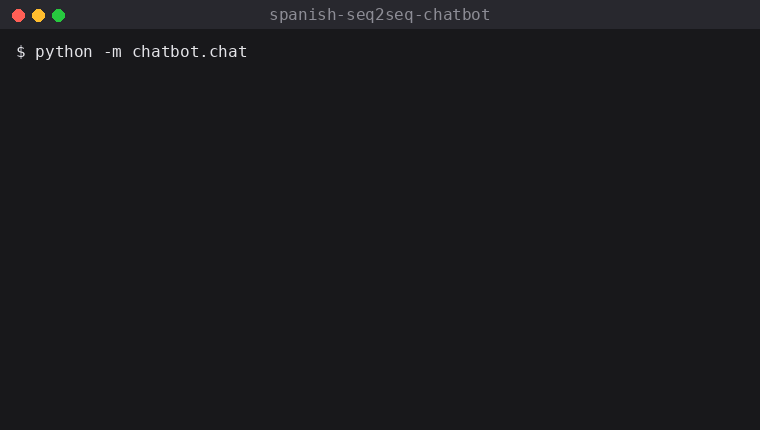
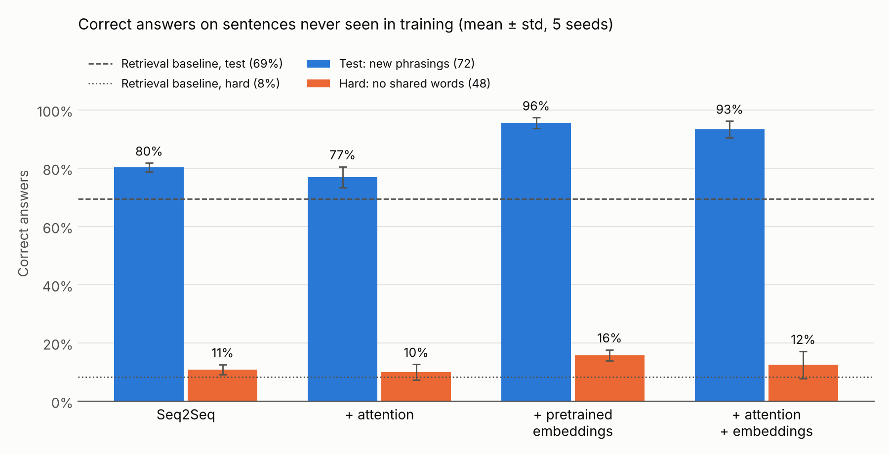
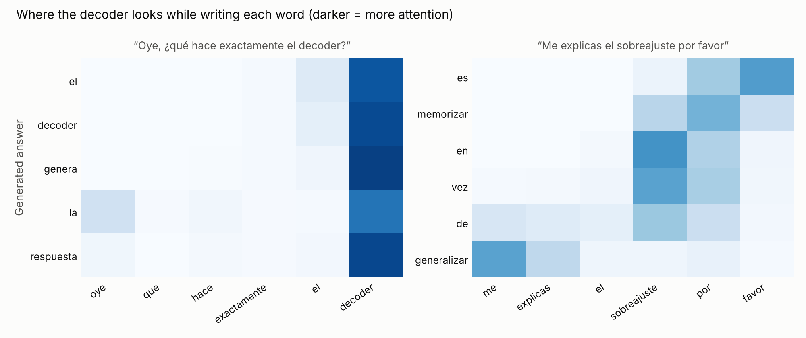

# Spanish Seq2Seq chatbot

A generative chatbot in Spanish built with a Seq2Seq (encoder-decoder) LSTM in Keras. It writes its answers word by word, and the project measures how well it handles questions phrased in ways it has never seen.

It started as an assignment for my Machine Learning course at the University of Granada. The first version worked on the sentences it was trained on but failed as soon as a question was worded differently. This repository is the extended version: a larger dataset, an honest evaluation, and two improvements, **attention** and **pretrained Spanish word embeddings**, compared over five random seeds each.

<p align="center">
  
</p>

## Results

Every version is trained 5 times with different seeds. Accuracy is the share of answers that exactly match one of the valid answers for that question.

<p align="center">
  
</p>

| Version | Validation | Test (new phrasings) | Hard (no shared words) |
|---|:---:|:---:|:---:|
| Retrieval baseline (nearest sentence, spaCy vectors) | 71 % | 69 % | 8 % |
| Seq2Seq | 72 % | 80 % ± 2 | 11 % ± 2 |
| Seq2Seq + attention | 78 % | 77 % ± 4 | 10 % ± 3 |
| Seq2Seq + pretrained embeddings | 75 % | **96 % ± 2** | **16 % ± 2** |
| **Seq2Seq + attention + pretrained embeddings** (final) | **85 %** | 93 % ± 3 | 12 % ± 5 |

What the numbers show:

- **Pretrained embeddings are the improvement that works.** Test accuracy goes from 80 % to 96 % with the same data and almost the same architecture. The questions the base model got wrong either contained a word it had never seen, like *define*, *aprendes* or *gracioso*, which it could only read as `<unk>`, or an expression it had only seen in another intent: *me explicas* only appeared in *Me lo explicas* ("I don't understand"), so *Me explicas el encoder* got the wrong answer. With spaCy's vectors new words land close to ones it knows (*define* is next to *significa* and *explícame*), and the model learns to rely on the keyword of the question.
- **Attention does not help here.** Questions are 3 to 6 words long and each intent depends on one or two keywords, so the final LSTM state already captures them. Attention is meant for long sentences, as in translation. It does make the model easier to inspect (see below).
- **I picked the final version on validation, not on test.** Attention + embeddings scored best on validation (85 %). On test the version without attention is slightly ahead, but with 24 validation sentences the gap is within the noise, and choosing by test would make the test score meaningless.
- **The hard set is still hard.** These are paraphrases with no content words in common with training, like *Me echas una mano* for *Necesito ayuda*. Word vectors help when there is a close word (*¿De qué estás construido?* is understood because *construido* is close to *hecho* and *arquitectura*), but they don't capture the meaning of whole sentences.
- **Generating beats retrieving.** Averaging word vectors and returning the answer of the closest training sentence reaches 69 % on test, well below every generative version.

## What the model looks at

With attention, every word the decoder writes comes with a weight over the words of the question. In the first example the model ignores *oye*, *qué*, *hace* and *exactamente* and looks almost only at *decoder*, the one word that decides the answer.

<p align="center">
  
</p>

## Dataset

[`data/intents.json`](data/intents.json) holds 24 intents: small talk (greetings, time, weather, jokes...) and questions about how the chatbot itself works (encoder, decoder, LSTM, attention, embeddings, overfitting). Each intent has one to three valid answers and its sentences are split by hand:

| Split | Sentences | Purpose |
|---|:---:|---|
| train | 162 (648 after augmentation) | Training |
| val | 24 | Early stopping and choosing the final version |
| test | 72 | New phrasings that share some keyword with training |
| hard | 48 | Paraphrases with no content words in common with training |

Training sentences are augmented 3× by adding a filler word in front (*oye*, *perdona*...), a tag at the end (*por favor*...) or dropping one word.

## How it works

- **Text:** lowercase, accents and punctuation removed, split into words ([`text.py`](src/chatbot/text.py)).
- **Model:** Embedding + LSTM encoder (128 units), Embedding + LSTM decoder initialised with the encoder's final state, and a softmax over the answer vocabulary ([`model.py`](src/chatbot/model.py)). Teacher forcing in training, greedy decoding at inference, batched over many sentences at once.
- **Attention:** Luong (dot-product) attention over the encoder outputs, concatenated with the decoder output and projected with a tanh layer before the softmax.
- **Pretrained embeddings:** the encoder uses the 300-dimensional vectors of spaCy's `es_core_news_md`, normalised and **frozen**, with a vocabulary of about 350,000 words. If they were fine-tuned, only the training words would move and new words would stop being close to them. The 8 training words spaCy doesn't know (*seq2seq*, *lstm*...) get their own random vector ([`vocab.py`](src/chatbot/vocab.py)).
- **Training:** Adam, dropout 0.2, batch size 8, early stopping on validation loss with patience 25, restoring the best weights.

## Run it

```bash
pip install -r requirements.txt
python -m spacy download es_core_news_md

cd src
python -m chatbot.chat                  # talk to the final model (trains it first, under a minute on CPU)
python -m chatbot.experiments           # retrain the 4 versions x 5 seeds, writes results/
python -m chatbot.figures               # redraws figures/ from results/
```

[`notebooks/chatbot.ipynb`](notebooks/chatbot.ipynb) walks through the whole project step by step (in Spanish).

## Project structure

```
data/intents.json        intents, answers and train/val/test/hard splits
src/chatbot/
├── text.py              normalisation and tokenisation
├── data.py              loading the intents and data augmentation
├── vocab.py             vocabularies, including the spaCy-based one
├── model.py             Seq2Seq model with optional attention, greedy decoding
├── bot.py               Chatbot class: training and answering
├── retrieval.py         nearest-sentence baseline
├── experiments.py       4 versions x 5 seeds -> results/
├── figures.py           plots for this README
└── chat.py              chat in the terminal
results/                 metrics, every generated answer, training curves
notebooks/chatbot.ipynb  step-by-step walkthrough
```

## Limitations and next steps

- The main limit is meaning beyond single words: *Me echas una mano* and *Estoy perdido* are still answered wrongly. Sentence embeddings or a pretrained Transformer for Spanish would address exactly that.
- 162 training sentences for 24 intents is very little; real conversations would be the biggest improvement.
- Exact match is a strict metric: an answer with one wrong word counts as a failure.
